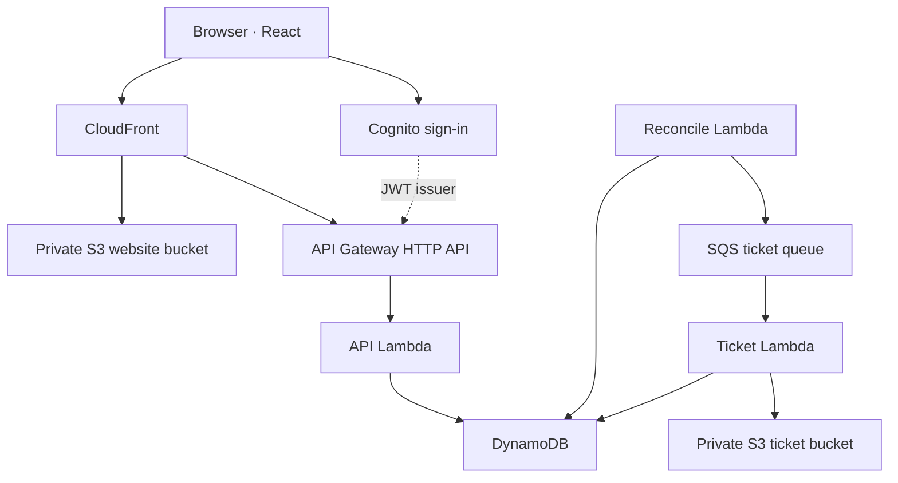

# FestFlow

FestFlow is a serverless demo for a Bengaluru film and food festival. A customer picks a screening, reserves seats and an optional food pickup slot, simulates payment, and receives a QR ticket. Venue staff can check in a ticket, kitchen staff can manage pickup orders, and administrators can assign operator scopes and view audit history.

## Architecture



| Tier | AWS services | Why they are used |
| --- | --- | --- |
| Presentation | CloudFront and private S3 | CloudFront serves the React site over HTTPS and forwards `/api/*` to API Gateway. Origin Access Control grants CloudFront access to the website bucket. |
| Application | API Gateway, Cognito and Lambda | Cognito signs users in. API Gateway validates tokens on protected routes. The API Lambda applies booking and role rules. |
| Data and background processing | DynamoDB, SQS and private S3 | DynamoDB records inventory, bookings and ticket work. SQS buffers that work so the ticket worker can retry independently. The ticket bucket stores generated QR PNG files. |

When a customer reserves a seat, DynamoDB checks availability and writes the temporary hold in one transaction. Simulated approval confirms the booking and records pending ticket work. Reconcile dispatches that work to SQS and releases expired holds. The Ticket Lambda reads the queue, generates the QR PNG, and marks the ticket ready. [Design and data model](docs/01-design.md) · [Staff workflows](docs/03-workflows.md)

## Choose a deployment path

| Path | Use it when | What you need |
| --- | --- | --- |
| [A. CloudFormation (CFT)](#a-cloudformation-cft) | You want AWS to provision the stack from a template. | AWS CLI v2, AWS SAM CLI, Node.js 22+, npm, Bash, jq and curl. |
| [B. Manual AWS Console](#b-manual-aws-console) | You want to create and connect each AWS resource yourself. | An AWS account, a browser, a text editor and the files in `manual/`. |

Use a demo account with billing and service permissions checked before creating resources. Both paths use `us-east-1` in the examples. Each creates an independent deployment. Payments are simulated.

## A. CloudFormation (CFT)

The [template](template.yaml) is a CloudFormation template with an AWS SAM transform. SAM builds the Lambda code. The repository scripts package it into S3 and create a CloudFormation change set for review.

1. Configure an AWS CLI profile for your demo account. In **S3 → Buckets**, have a private artifact bucket in the same account and region, with Block Public Access and SSE-S3. The artifact bucket holds Lambda uploads during provisioning.
2. From the repository root, install dependencies and create the first change set. Replace all sample values below with your account settings.

   ```bash
   export AWS_PROFILE=festflow-lab AWS_REGION=us-east-1 STACK=festflow-demo
   export EXPECTED_ACCOUNT=123456789012
   export ARTIFACT_BUCKET=your-private-artifact-bucket
   export LOGIN_PREFIX=festflow-your-unique-suffix

   npm ci
   npm run check
   bash scripts/preflight.sh
   bash scripts/plan.sh
   jq '.Changes[].ResourceChange | {Action, LogicalResourceId, ResourceType, Replacement}' .festflow/change-set.json
   ```

3. Review the changes and IAM resources in **CloudFormation → Stacks → festflow-demo → Change sets**. Run the following command after review, or use **Execute** in the Console.

   ```bash
   bash scripts/apply.sh "$(cat .festflow/change-set.arn)"
   ```

4. Read the new CloudFront hostname and plan the Cognito callback update. Review the second change set and execute it. The first stack creates the CloudFront hostname. The second update lets Cognito return users to that hostname after sign-in.

   ```bash
   source scripts/common.sh
   stack_outputs="$(outputs)"
   export EDGE_HOST="$(out EdgeHost)"
   bash scripts/plan.sh
   # Review the update before executing it.
   bash scripts/apply.sh "$(cat .festflow/change-set.arn)"
   ```

5. Seed the festival catalogue, build the site, publish it to the stack's website bucket, and smoke-test the public URL.

   ```bash
   stack_outputs="$(outputs)"
   TABLE_NAME="$(out TableName)" npm run seed
   npm run build
   bash scripts/publish.sh demo-v1
   bash scripts/smoke.sh "$(out PublicUrl)"
   ```

6. In **Cognito → User pools → Users**, create a demo customer. Open the stack's `PublicUrl` output, sign in and complete the [booking test](#test-the-deployment). The template schedules Reconcile to run once a minute. Follow the [deployment notes](docs/02-deploy.md#login-and-verification) to create staff users and assign scopes.

[CloudFormation deployment guide](docs/02-deploy.md) · [Operations and teardown](docs/04-operations.md)

## B. Manual AWS Console

Download and extract the repository ZIP. The [Console walkthrough](manual/START-HERE.md) gives the exact menu paths and values. Follow this order. The manual deployment uses the included Lambda ZIPs and website build, so you can complete the AWS setup in the browser.

| Step | Create or configure | Verify before continuing |
| --- | --- | --- |
| 1 | Create private S3 website and ticket buckets. Upload the [website build](manual/website/) and create a CloudFront distribution with the website bucket as its S3 REST origin. Set OAC to sign requests and paste the CloudFront bucket policy into S3. Set `index.html` as the default root object. | The CloudFront URL shows the FestFlow page. |
| 2 | Create the on-demand DynamoDB table `festflow-demo` with String keys `pk` and `sk`. Create the `Lookup`, `Venue` and `Kitchen` indexes, then paste each [seed item](manual/dynamodb-items/) into the Console. | Last Call, seat A1, the kitchen, and pickup Window 3 exist. Use future screening and pickup times. |
| 3 | Create Standard SQS queues `festflow-tickets` and `festflow-tickets-dlq`. Set the main queue visibility timeout to 120 seconds and configure its dead-letter queue. | Record the main queue URL for Reconcile. |
| 4 | Create CloudWatch log groups, three Lambda execution roles with the [IAM policies](manual/iam/), and the API, Reconcile and Ticket functions. Upload the [Lambda ZIPs](manual/lambda/) and set the exact handlers and environment variables from the walkthrough. Attach the main queue trigger to the Ticket function. | The trigger is enabled and all three functions use Node.js 22.x. |
| 5 | Create a Cognito user pool and a public SPA app client using authorization code flow, PKCE and `openid`. Use your CloudFront homepage with its trailing slash as the callback and sign-out URL. Create an API Gateway HTTP API with a `$default` stage, payload version 2.0, and the [route table](manual/API-Routes.md). | `GET /api/events` returns the demo screening. The protected routes use the JWT authorizer with the pool issuer and SPA client ID. |
| 6 | Add the API Gateway hostname as a CloudFront origin with no origin path, and create the `/api/*` behavior using `CachingDisabled` and `AllViewerExceptHostHeader`. Update and upload [auth-config.json](manual/settings/auth-config.json). Publish the [SPA rewrite](manual/settings/spa-rewrite.js) and associate it with the default website behavior on Viewer request. | Through CloudFront, the events route returns JSON and directly opening a screening URL loads the app. |
| 7 | Create a Cognito test customer, place a hold and simulate approval. In Lambda, test `festflow-reconcile` with `{}`. For recurring dispatch and hold expiry, optionally configure EventBridge Scheduler at one-minute intervals. | The Ticket Lambda consumes the SQS message, the QR becomes Ready, and the ticket bucket contains the PNG. |

[Exact Console steps and cleanup](manual/START-HERE.md) · [API route authorization](manual/API-Routes.md)

## Test the deployment

1. Open the CloudFront homepage. Browse to **Last Call**, choose seat **A1**, add a **Pepper mushroom puff**, and choose **Window 3**.
2. Sign in and reserve. Confirm that the booking becomes `HELD` with an expiry time.
3. Select **Simulate approval**. The booking is confirmed. Allow Reconcile to run, or manually test it with `{}` on a manual deployment without the schedule.
4. Open **My bookings** and refresh the booking detail. Confirm the ticket becomes **Ready** and a QR is displayed. A staff operator can check it in using the venue dashboard after an administrator assigns the venue scope.

| Symptom | Where to check |
| --- | --- |
| CloudFront returns XML `AccessDenied`. | Check that the requested S3 key exists at the expected location, and that the OAC policy references this distribution. |
| A direct screening URL fails. | Check that the published Viewer request rewrite is on the default website behavior. |
| `/api/me` returns `401` with invalid audience. | Match the JWT authorizer audience to the Cognito app client ID in `auth-config.json`, then sign out and sign back in. The issuer uses the user pool ID. |
| A pickup window is missing. | Check the DynamoDB seed item, its show and kitchen relationships, and that its pickup time is still in the future. |
| A booking is confirmed but the QR stays pending. | Check Reconcile logs, the SQS queue and dead-letter queue, and the enabled Ticket trigger. Review Ticket Lambda logs for S3 or DynamoDB errors. |

## Local development

Use Node.js 22+, npm, Java 17+ and curl. With DynamoDB Local running, start the API and web app from separate terminals.

```bash
npm ci
bash scripts/ddb-local.sh
```

```bash
npm run dev
# Open http://localhost:5173
```

Run `npm run check`, `npm test` with DynamoDB Local running, and `npm run build`. See [verification](docs/06-verification.md) and the [demo walkthrough](docs/05-demo.md).

| Directory or file | Contents |
| --- | --- |
| [`template.yaml`](template.yaml) | AWS SAM and CloudFormation infrastructure |
| [`src/`](src/) | API, booking transactions, DynamoDB access and QR processing |
| [`web/`](web/) | React site and Cognito sign-in |
| [`manual/`](manual/START-HERE.md) | Console settings, seed data, IAM policies and upload files |
| [`scripts/`](scripts/) | Local setup, change sets, catalogue seed, web publishing and teardown |
| [`docs/`](docs/) | Architecture, workflows, operations, and verification |

