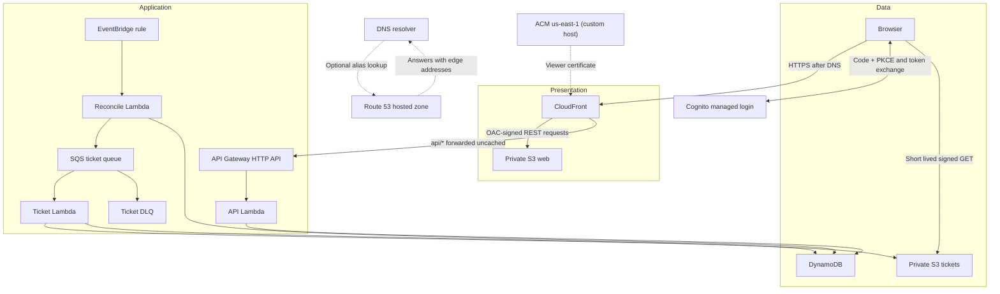
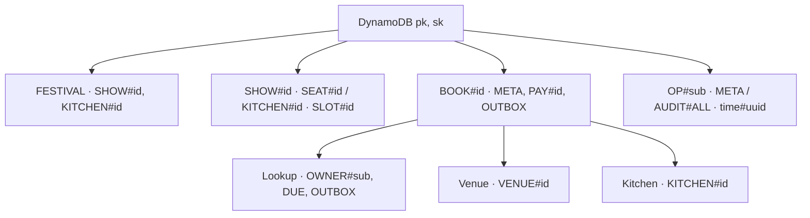
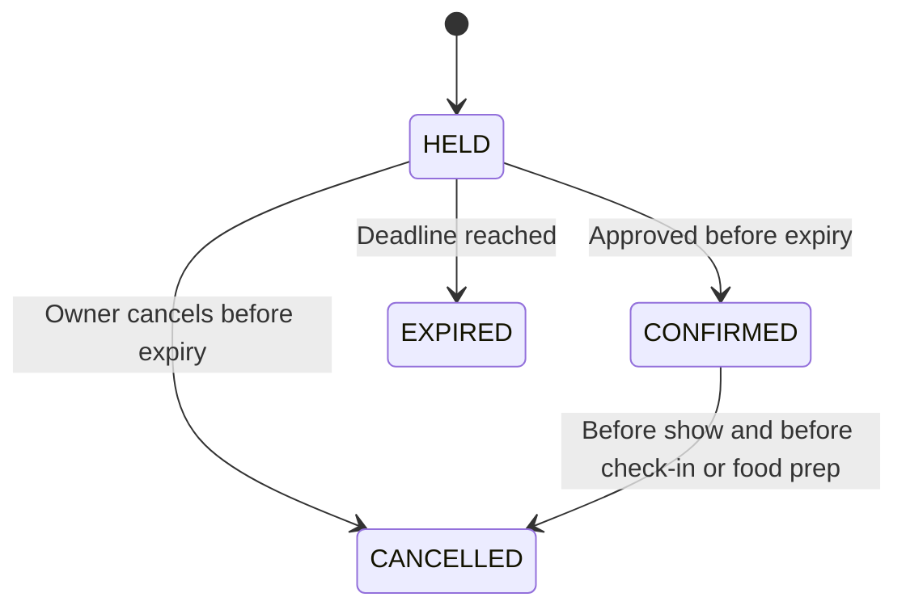

# Milestone 1 · Architecture, contracts and preflight

FestFlow sells a numbered festival seat and optionally reserves kitchen throughput in the same checkout. The original demo covers Bengaluru’s fictional Banyan Courtyard and Silk Mill Studio. Each food item consumes one slot unit. A booking can have one screening, up to six distinct seats and up to six food units from one kitchen at that venue. Timestamps are stored in UTC and rendered as Asia/Kolkata. All prices are demo INR amounts.

The browser resolves a hostname first. With a vanity hostname, Route 53 answers using the CloudFront alias and ACM supplies the viewer certificate after DNS validation. CloudFront selects an origin by path. The default behavior rewrites extensionless SPA routes before forwarding them to S3. The API behavior sends the original path, bearer token and query string to API Gateway. The gateway verifies Cognito JWTs on protected routes. Lambda verifies access-token type, the actor’s role and the resource scope before reading or writing data.

## API contract

All endpoints use the `/api` prefix. Responses are JSON. Error responses contain `error`, `message` and `requestId`. Status meanings are 400 invalid input, 401 missing or invalid identity, 403 authenticated actor without access, 404 missing resource, and 409 conflicting inventory or state. For same-origin requests use the CloudFront hostname as the base URL.

| Method and path | Actor | Input and result |
| --- | --- | --- |
| GET /events | Public | Screenings and venue summaries |
| GET /shows/{id}/availability | Public | Seats with available flag, venue kitchen menu and pickup capacity |
| GET /me | Signed in | Role and assigned scopes |
| POST /holds | Customer | `{requestId,showId,seats,food?:{kitchenId,slotId,items:[{id,qty}]}}`; returns booking with expiry |
| POST /bookings/{id}/payment | Owner | `{attemptId,scenario:"approve"\|"decline"}`; returns simulator outcome and current booking |
| GET /bookings | Customer | Owner history |
| GET /bookings/{id} | Owner | Current booking and separate ticket status |
| POST /bookings/{id}/cancel | Owner | Cancel the hold or eligible confirmed booking |
| GET /bookings/{id}/ticket | Owner | A short-lived QR PNG download URL |
| GET /venue/{id}/bookings | Assigned venue | Venue booking records |
| PATCH /venue/{id}/shows/{show} | Assigned venue | `{open?:boolean,startsAt?:ISO8601}`; time edits require zero bookings ever created for that show |
| PATCH /venue/{id}/shows/{show}/seats/{seat} | Assigned venue | `{blocked:boolean}`; seats must be unreserved |
| POST /venue/{id}/check-in | Assigned venue | `{code}`; one successful admission per booking |
| GET /kitchen/{id}/orders | Assigned kitchen | Pickup windows and confirmed orders |
| PATCH /kitchen/{id}/orders/{id} | Assigned kitchen | `{status:"PREPARING"\|"READY"\|"COLLECTED"}` |
| GET /admin/audit | Admin | Latest 100 audit events |
| PUT /admin/operators/{sub} | Admin | `{role:"venue"\|"kitchen"\|"none",scopes:[...]}`; scopes are complete replacement |

## Data model

Seat maps and pickup-slot lists query their base partitions with strongly consistent reads. Each booking and its payment receipts and outbox share a base partition. The customer history uses a separate owner pointer item in the Lookup GSI, which leaves the booking free to enter or leave the sparse DUE partition. Venue and kitchen lists use sparse GSIs, so dashboards can briefly lag. Decision-making reads the authoritative base row and conditional writes. A DUE sort key uses UTC ISO time and a booking suffix. An OUTBOX sort key similarly orders pending jobs. Due work is paged in bounded batches. One global audit partition suits the demo. Large launches would require partitioning due work and audit writes.

Hold creation reserves every selected seat and increments the pickup counter in one transaction. Failed payments leave a hold until its deadline. Confirmation keeps inventory reserved and creates an outbox record. Expiry and cancellation clear seats and decrement the pickup counter exactly once, in the transaction that changes the booking. Neither TTL timing nor the dashboard’s refresh governs inventory. A worker delay keeps the seats reserved temporarily while a late payment still fails. Nesting multiple resource reservations follows the same pattern for concessions at sports fixtures, seats in conference breakout sessions, or a room and clinician in a clinic. Sports changes the pickup limit per stand, conferences add attendee schedule conflicts, and clinics reserve overlapping duration blocks and require privacy controls.

## Preflight and cost

Use [the AWS operations guide](04-operations.md) for account identity, service eligibility, quota checks and gross pricing. Use an isolated demo stack. A local app and DynamoDB Local are available without an AWS account. This design milestone adds no resources.
