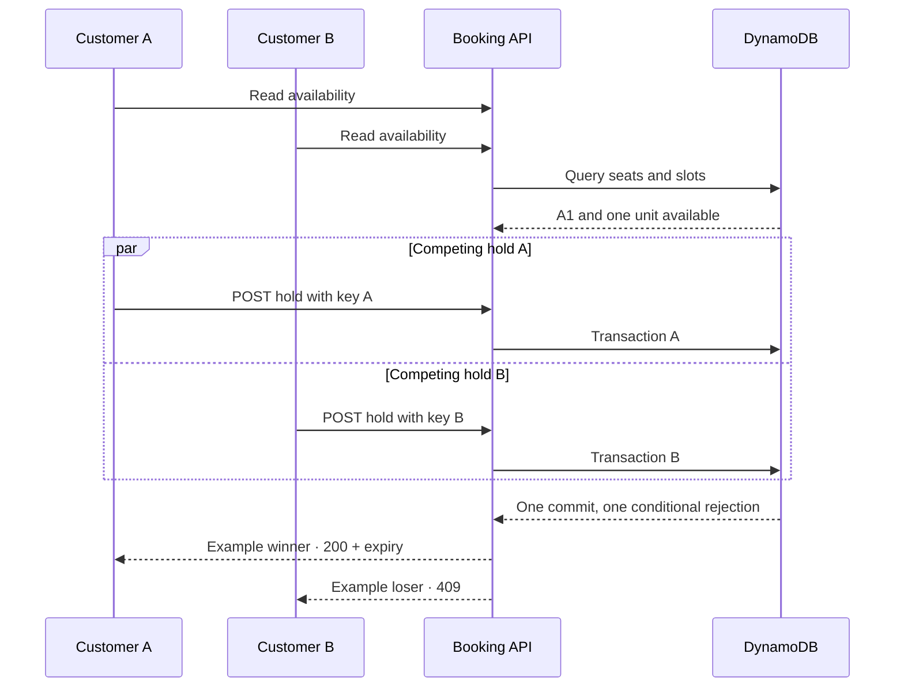

# Milestone 2 · Deployable customer journey

The local environment exercises the same TypeScript handlers, DynamoDB expressions and React client as AWS. Run the two terminals in the repository README. Open two independent browser profiles or one normal and one private window. Sign in as Customer A and Customer B. Both can choose seat A1 at **Last Call** and one Pepper mushroom puff from pickup Window 3.



Availability reads are advisory. Both browsers can display the final seat before either write. The hold’s conditional transaction checks the seat, the pickup counter, the show start and its booking flag. It writes the hold, owner pointer and audit event together. The UI refreshes every eight seconds on the selection screen, skips hidden tabs, and aborts on navigation. The client saves a pending checkout key and payload per user per tab. “Resume last checkout” resends that payload after a reload or lost response. A 409 refreshes availability and asks the customer to review the selection.

At 90 seconds per seat-selection session this produces up to about 12 availability reads. A WebSocket upgrade would send inventory-change notifications after commits, then refresh the authoritative snapshot. It would add authenticated connections, reconnect and resync handling, per-screening subscriptions and message charges. The transactional checks would stay in the booking path.

## Prepare the AWS change set

Prerequisites are AWS CLI v2, AWS SAM CLI, Node.js 22+, npm, jq, curl and Bash. Use an AWS CLI profile for an isolated demo account. Confirm permissions, billing plan and region using [preflight](04-operations.md#account-and-cost-preflight). The artifact bucket is an existing private bucket in the same region. Reuse one or create one deliberately in S3 → Buckets → Create bucket with Block Public Access and SSE-S3 enabled. It holds Lambda build artifacts before the stack exists.

```bash
export AWS_PROFILE=festflow-lab AWS_REGION=us-east-1 STACK=festflow-demo
export EXPECTED_ACCOUNT=123456789012                  # Replace with your account ID
export ARTIFACT_BUCKET=your-existing-private-artifact-bucket
export LOGIN_PREFIX=festflow-your-unique-suffix      # Lowercase and globally unique in the region
# Optional, if your account uses an approved CloudFormation service role:
# export CFN_ROLE_ARN=arn:aws:iam::123456789012:role/FestFlowCloudFormation
npm ci
npm run check
bash scripts/preflight.sh
bash scripts/plan.sh
jq '.Changes[].ResourceChange | {Action, LogicalResourceId, ResourceType, Replacement}' .festflow/change-set.json
```

**Console equivalent.** CloudFormation → Stacks → the demo stack → Change sets → latest FestFlow change set. Check resource count, IAM additions and replacements. Keep the staging bucket and CLI profile from the same account. The script packages with CloudFormation after building with SAM. It creates and describes a change set without executing it. An initial plan can leave a stack shell in `REVIEW_IN_PROGRESS`. A real change set has an AWS ARN. An offline template cannot create one.

Execute only after the change set is approved. If you execute through CloudFormation → Change sets → Execute, skip the matching `apply.sh` call.

```bash
bash scripts/apply.sh "$(cat .festflow/change-set.arn)"
source scripts/common.sh
stack_outputs="$(outputs)"
export EDGE_HOST="$(out EdgeHost)"
# Review then apply this UPDATE to register the actual Cognito callback.
bash scripts/plan.sh
bash scripts/apply.sh "$(cat .festflow/change-set.arn)"
stack_outputs="$(outputs)"
TABLE_NAME="$(out TableName)" npm run seed
npm run build
bash scripts/publish.sh demo-v1
bash scripts/smoke.sh "$(out PublicUrl)"
```

Two change sets avoid a dependency cycle. CloudFront needs the API origin, the API needs the Cognito app client, and the app client eventually needs the CloudFront hostname. The initial client uses a loopback callback placeholder. The second update registers the actual edge URL. Existing parameters are preserved unless an override is passed. Clear blank-allowed parameters with `__CLEAR__`. The certificate parameter has a syntactically valid sentinel used only when the custom domain is disabled.

## Login and verification

1. In Cognito → User pools → the FestFlow pool → App clients, confirm authorization code flow, the exact HTTPS callback including trailing slash, and the OpenID scope. The pool uses the Cognito-hosted prefix and hosted UI (version 1) with Lite. The client has no secret.
2. In Users → Create user, create five test identities (two customers, one venue operator, one kitchen operator and one admin). Use email addresses you control, suppress invitations if you set passwords manually through the approved workflow, and complete the password challenge on first sign-in if required. Use Groups to assign the three staff identities to `venue`, `kitchen` and `admin`. Customers require no groups. Use one staff group per identity.
3. The CLI equivalent for user and group checks is below. Use the Cognito internal username returned by the first command for operations on the user. Keep passwords and bearer tokens out of command logs.

```bash
pool="$(out UserPoolId)"
aws_call cognito-idp admin-get-user --user-pool-id "$pool" --username "$OPERATOR_EMAIL" \
  --query '{Username:Username,Subject:UserAttributes[?Name==`sub`].Value|[0]}'
aws_call cognito-idp admin-add-user-to-group --user-pool-id "$pool" \
  --username "$COGNITO_USERNAME" --group-name venue
aws_call cognito-idp admin-list-groups-for-user --user-pool-id "$pool" --username "$COGNITO_USERNAME"
```

4. Sign into FestFlow as admin, open Operations and save scope `silk` for the venue operator or `tiffin` for the kitchen operator. Paste the corresponding subject UUID. Staff should sign out and back in after a Cognito group change. Scope data is checked on every request.
5. Open the edge URL as customers. Run the two-browser race, let the winner's first hold expire, then reserve and simulate a decline followed by an approval. A live expiry can take up to approximately another minute after the deadline under light load. Review My bookings, refresh the detail URL directly, and verify a later ticket status. For direct checks, use CloudFormation Outputs and the Console paths in the operations guide.

### What the CloudFront request does

| Request | Edge handling | Expected response |
| --- | --- | --- |
| `GET /` or `GET /bookings/123` | Viewer function rewrites to `/index.html` only on the web behavior | HTML, zero minimum TTL and revalidation |
| `GET /assets/<hash>.js` | Private S3 REST origin with CloudFront OAC, same path | Immutable asset, one-year browser cache |
| `GET /auth-config.json` | Web origin with `no-store` | Cognito login URL and public client ID |
| `GET /api/me` | Original path sent to `<api-id>.execute-api.<region>.amazonaws.com`, `$default` stage | 401 without token, 200 for an assigned valid identity |
| `/api/…` authenticated | CachingDisabled and AllViewerExceptHostHeader forward bearer token and query strings. Origin Host is rewritten to the execute-api hostname | API status is preserved, including 401, 403 and 404 |

The execute-api hostname remains reachable. It runs the same authorizer and Lambda scope controls. An origin-only network restriction is outside this demo. Official definitions for the [cache policy](https://docs.aws.amazon.com/AmazonCloudFront/latest/DeveloperGuide/using-managed-cache-policies.html), [origin request policy](https://docs.aws.amazon.com/AmazonCloudFront/latest/DeveloperGuide/using-managed-origin-request-policies.html) and [JWT authorizer](https://docs.aws.amazon.com/apigateway/latest/developerguide/http-api-jwt-authorizer.html).
