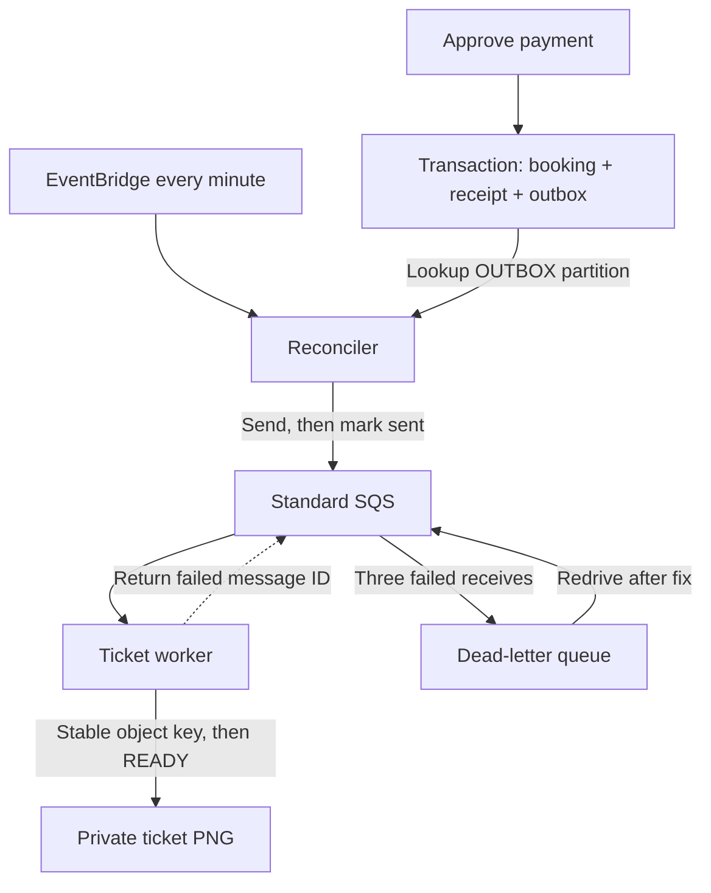

# Milestone 3 · Venue, kitchen and ticket delivery

Use the same commands and resources as Milestone 2. In local mode choose demo identities. In AWS use Cognito staff groups and save the corresponding assignments in the admin dashboard. Validate the paths below before demonstrating the recovery drill.



Payment commits the booking, receipt and outbox together. The minute worker reads pending records and marks them sent after successful enqueue. If it stops between send and mark, the next invocation may send the job again. If it stops before send, the pending marker survives. Standard SQS can also deliver duplicates. The ticket worker produces the same QR bytes and stable object key, then conditionally writes READY and an audit event. A partial batch failure returns the failed message IDs. SQS retries after the visibility timeout and sends exhausted messages to the DLQ. On the last app-level failure the booking stays CONFIRMED and its ticket changes to FAILED if it was still PENDING. If Lambda is unavailable or a job is malformed, use the DLQ as the primary signal. A successfully redriven job moves FAILED to READY.

The ticket endpoint first reads the booking and verifies ownership and CONFIRMED+READY. It then issues a signed GET valid for up to 90 seconds. The QR contains a version prefix, booking ID and random secret. The venue scans or pastes the code, verifies its scope and the secret, and conditionally writes check-in time only for a confirmed booking with no prior check-in. A copied PNG can be presented again, but a second admission is rejected. Cancellation can invalidate admission even when a previously issued short-lived PNG URL still works.

### Expected HTTP and database outcomes

| Scenario | HTTP result | DynamoDB state and inventory | User-visible result |
| --- | --- | --- | --- |
| Both customers request the last seat and slot | 200, 409 | One HELD row, A1 owned by winner, pickup used 0 → 1 | Winner sees countdown, loser sees availability conflict |
| Pickup full with free seats | 409 | No hold row and no seat writes, pickup used stays at capacity | Review live availability and choose a new window |
| Checkout submits twice or resumes after reload | 200 with same ID twice | One owner pointer, lock set and counter increment | Same reservation opens |
| Decline, duplicate approval or late retry | Decline 200, same approved attempt 200, new late attempt 409 | One receipt per accepted attempt. Decline leaves HELD. Approval keeps stock allocated. Late attempt writes no receipt or stock changes | Decline notice, same approved outcome, or hold-window error |
| Approval and expiry race | 200 or 409 for payment; at most one expiry mutation | CONFIRMED and allocated, or EXPIRED and released once | Reservation confirms or hold expires |
| Cancel twice | 200 both | One CANCELLED transition and one release | Cancellation remains visible |
| Confirmed booking loses ticket job | Payment 200 and ticket GET 409 until ready | CONFIRMED stays valid, stock allocated, PENDING → FAILED → READY on recovery | Booking status and ticket status are shown separately |
| Two venue operators check the same code | 200 and 409 | One checkedAt write, stock untouched | First admission succeeds, second blocked |
| Operator accesses another venue | 403 | No venue data returned and no writes | Access denied |

### Inspect the results

```bash
source scripts/common.sh
stack_outputs="$(outputs)"
table="$(out TableName)"
aws_call dynamodb get-item --consistent-read --table-name "$table" \
  --key "$(jq -cn --arg id "$BOOKING_ID" '{pk:{S:("BOOK#"+$id)},sk:{S:"META"}}')" \
  --projection-expression '#s, ticket, checkedAt' --expression-attribute-names '{"#s":"status"}'
aws_call dynamodb query --consistent-read --table-name "$table" \
  --key-condition-expression 'pk = :p AND begins_with(sk,:s)' \
  --expression-attribute-values '{":p":{"S":"SHOW#last-call"},":s":{"S":"SEAT#"}}'
aws_call dynamodb get-item --consistent-read --table-name "$table" \
  --key '{"pk":{"S":"KITCHEN#tiffin"},"sk":{"S":"SLOT#window-3"}}'
```

DynamoDB → Tables → FestFlow table → Explore table items shows the same rows. Avoid pasting QR secrets or raw records into shared dashboards. Payment events use the checkout-selected simulator scenario and backend-computed costs. No card data or real payment-provider callback is involved. A late new attempt is checked against the server-sampled time, then the transaction arbitrates with expiry on the booking row. Worker backlog can make inventory temporarily stale but cannot give two customers the same seat. DynamoDB TTL's asynchronous deletes do not run release transactions. The demo leaves TTL off, so booking records and receipts are available for replays and audit. Only the hold worker releases reserved inventory.

### Bounded AWS test

On your own test stack with a free Last Call fixture, sign in as the two separate customer identities. Retrieve their short-lived access tokens only from their own browser sessions, keep them out of history and clear environment variables afterward.

```bash
export FESTFLOW_URL=https://your-distribution.cloudfront.net
read -rsp 'Customer A access token: ' FESTFLOW_TOKEN_A; echo
read -rsp 'Customer B access token: ' FESTFLOW_TOKEN_B; echo
export FESTFLOW_TOKEN_A FESTFLOW_TOKEN_B
npm run race:aws
unset FESTFLOW_TOKEN_A FESTFLOW_TOKEN_B
```

The script sends two concurrent hold requests once, verifies both responses and inventory, and cancels the winning hold. A lost HTTP response can leave a reservation until scheduled expiry. The local test suite injects clock values so it can test late payment and expiry arbitration without waiting two minutes.
