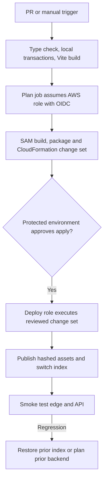
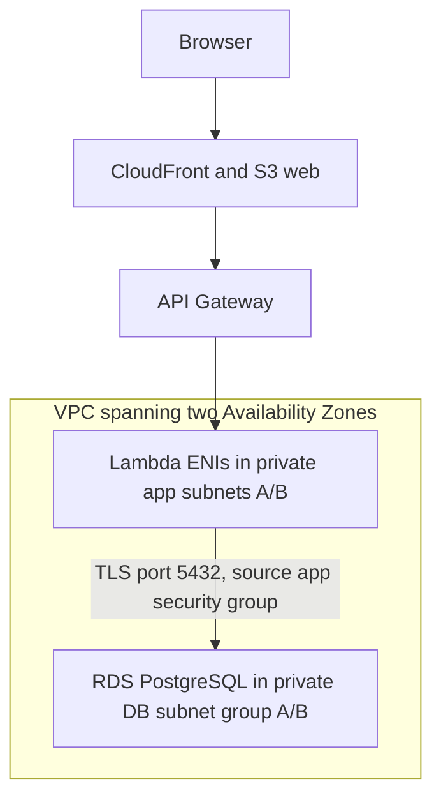

# Milestone 4 · AWS administration and operations

## Account and cost preflight

In Billing and Cost Management → Home, Credits, and Free Tier, check your account plan, remaining credits, expiration date and eligibility. New eligible AWS customers on the current Free plan receive USD 100 in initial credits and may earn up to USD 100 more. The Free plan ends after six months or credit exhaustion, whichever comes first, and restricts features. Paid-plan usage can incur charges after allowances and credits. Accounts created before July 15, 2025 can have different rules. Confirm the rules displayed on your actual account. [Free Tier rules](https://aws.amazon.com/free/) · [Billing plan checks](https://docs.aws.amazon.com/awsaccountbilling/latest/aboutv2/free-tier-plans.html) · [Supported services and exceptions](https://docs.aws.amazon.com/accounts/latest/reference/supported-services-sign-up-new.html).

The default uses CloudFront pay-as-you-go, Cognito Lite hosted UI, Lambda regional functions and an EventBridge scheduled rule. AWS lists the default services in its new-plan service matrix. Verify your actual permissions and region, including any organization or service restrictions. Keep any missing core service on the local development path. If a scheduled rule is temporarily unavailable but Lambda is supported, disable scheduling with `RECONCILE_ENABLED=false` and invoke reconciliation manually while demonstrating, including after expiry and after approved payment. If Route 53 or ACM is unavailable, stay on the default CloudFront hostname. The default creates no VPC, NAT, ALB, EC2, RDS, custom domain, paid CDN plan or optional alarms.

```bash
bash scripts/preflight.sh
source scripts/common.sh
aws_call lambda get-account-settings --query AccountLimit
aws_call service-quotas list-service-quotas --service-code apigateway --query 'Quotas[?contains(QuotaName,`Throttle`)].{Name:QuotaName,Value:Value}'
aws_call service-quotas list-service-quotas --service-code dynamodb --query 'Quotas[0:8].{Name:QuotaName,Value:Value}'
aws_call service-quotas list-service-quotas --service-code cloudfront --query 'Quotas[0:8].{Name:QuotaName,Value:Value}'
```

In Service Quotas → AWS services select each service and check applied account quotas before deployment. Typical HTTP API regional account limit is 10,000 requests/sec and 5,000 burst in most Regions, while the stack sets a stage target of 20/sec and burst 40. Keep available Lambda account concurrency for API, expiry and the ticket mapping, whose maximum concurrency is two. DynamoDB transactions allow 100 distinct items and 4 MB; a hold uses at most 11 items here. Check existing CloudFront distributions, Cognito domains and SQS queues. [API Gateway quotas](https://docs.aws.amazon.com/apigateway/latest/developerguide/limits.html) · [Lambda quotas](https://docs.aws.amazon.com/lambda/latest/dg/gettingstarted-limits.html) · [DynamoDB transactions](https://docs.aws.amazon.com/amazondynamodb/latest/developerguide/transaction-apis.html).

### Gross estimate as of 21 November 2026

USD list-price model, primary region **us-east-1**, India edge traffic, a one-day demo versus a 30-day running stack. Estimates exclude taxes and use pre-allowance unit rates. Monthly assumptions assume multiple demo runs, with a new demo festival stack or deliberately reseeded dates as needed. The bundled fixture only sells seats before its showtimes. The AWS billing console is authoritative.

| Service and unit rate | One day | Low-traffic month |
| --- | ---: | ---: |
| HTTP API, USD 1/M small requests | 420 → **0.0004** | 8,000 → **0.0080** |
| Lambda, USD 0.20/M and USD 0.0000166667/GB-sec x86; 256 MB, 150 ms mean including minute ticks | 1,868 invocations → **0.0015** | 51,400 → **0.0424** |
| DynamoDB standard on-demand, USD 0.125/M reads, USD 0.625/M writes, USD 0.25/GB-month; units include transactional and index multipliers | 20k reads, 0.5k writes, 0.01 GB prorated → **0.0029** | 250k reads, 12k writes, 0.02 GB → **0.0438** |
| S3 Standard web, ticket and artifacts; USD 0.023/GB-month, USD 0.005/1k writes and USD 0.0004/1k reads | 0.02 GB prorated, 20 writes, 200 reads → **0.0002** | 0.10 GB, 300 writes, 5k reads → **0.0058** |
| CloudFront, India HTTPS USD 0.012/10k, USD 0.109/GB viewer, function USD 0.10/M; small origin request bodies budgeted separately | 800 HTTPS, 0.075 GB, 380 function calls → **0.0092** | 14k HTTPS, 0.9 GB, 6k function calls → **0.1155** |
| SQS Standard, USD 0.40/M including empty receives, requests in 64 KB units | 6k → **0.0024** | 180k → **0.0720** |
| CloudWatch Logs standard ingest USD 0.50/GB, plus small storage and query budget | 0.015 GB → **0.0080** | 0.25 GB → **0.1290** |
| Cognito Lite direct sign-ins, hypothetical pre-allowance USD 0.0055/MAU | 12 MAUs → **0.0660** | 150 MAUs → **0.8250** |
| EventBridge timer and CloudFormation for native resources, per-service usage above | **0.00** | **0.00** |
| **Rounded gross total** | **about USD 0.09** | **about USD 1.24** |

Traffic inputs are 20 visitors, 12 seat-selection sessions, about 144 polling calls and 8 confirmed bookings on day one. Monthly inputs are 400 visitors, 240 90-second seat-selection sessions, about 2,880 polling calls and 200 confirmed bookings across demos. API totals include read, poll and write calls. The minute worker runs about 1,440/day or 43,200/month. SQS estimate budgets empty long polls and delivery requests. Use billing metrics for actual request counts. Direct ticket downloads are small, typically a few KB each, and their US-East S3 transfer contribution at this scale rounds below one cent. Approval simulator requires no external payment service.

- **Free usage:** Compare your account’s shared usage with Lambda's 1M requests and 400,000 GB-seconds, SQS's 1M requests, CloudFront PAYG's 1 TB and 10M HTTP(S) requests, Cognito Lite's 10,000 direct/social MAUs, and eligible CloudWatch Logs allowances. API Gateway offers a time-limited allowance on eligible account plans. DynamoDB's free provisioned capacity is distinct from the template's on-demand request pricing.
- **Credits:** Eligible net service charges can deduct from available credits. USD 0 out of pocket is plausible during a small eligible demo, with unused allowances and credits. Inspect your actual credits and usage in Billing.
- **Out of pocket:** On a Paid plan, charges are possible if a service or usage is excluded, hosted zones or domain registrations are added, usage rises, or credits expire. In Billing → Budgets set an actual and forecast alert where available. Use a low threshold appropriate to your account, for example USD 2. Alerts lag usage and do not stop resources.

Official rate references [API Gateway](https://aws.amazon.com/api-gateway/pricing/) · [Lambda](https://aws.amazon.com/lambda/pricing/) · [DynamoDB](https://aws.amazon.com/dynamodb/pricing/) · [S3](https://aws.amazon.com/s3/pricing/) · [CloudFront PAYG](https://aws.amazon.com/cloudfront/pricing/pay-as-you-go/) · [SQS](https://aws.amazon.com/sqs/pricing/) · [CloudWatch](https://aws.amazon.com/cloudwatch/pricing/) · [Cognito](https://aws.amazon.com/cognito/pricing/) · [EventBridge](https://aws.amazon.com/eventbridge/pricing/) · [CloudFormation](https://aws.amazon.com/cloudformation/pricing/).

## Service responsibilities

| Service and why it is needed | What it owns and a concrete FestFlow path | Verify in the Console or CLI | Symptom, fix and recheck |
| --- | --- | --- | --- |
| CloudFormation/SAM, reviewable infrastructure | Parameters, dependencies, tags and runtime deployment. SAM expands HTTP routes and Lambda triggers into native resources | CloudFormation → Stacks → Change sets, Resources, Events, Outputs. Template lint and build with SAM | Failed change set → read Status reason or failed resource event → fix property or permission and create a new change set → confirm AVAILABLE |
| IAM/STS, scoped control-plane and runtime access | The CLI assumes a demo deployer identity. CloudFormation provisions resources with a service role where supplied. A Lambda role permits project table, index, bucket/prefix or queue actions | IAM → Roles → Trust relationships and Permissions. `aws sts get-caller-identity` returns intended account | AccessDenied → inspect role, permission boundary, session policy and service control policy → fix the missing scoped action and repeat the failed call |
| S3 web, durable private frontend | Assets and saved release indexes. CloudFront signs GETs through OAC and bucket policy permits that distribution | S3 → web bucket → Permissions → Block Public Access, Bucket policy, Objects. Direct unsigned URL returns 403 | Edge 403 → check index object and OAC SourceArn → republish or correct policy in CloudFormation → test edge and direct S3 |
| CloudFront, HTTPS and same-origin routing | Rewrites app paths and serves hashed assets. Sends bearer header, query strings and original API path to the gateway | CloudFront → Distribution → Origins, Behaviors, Functions. Check HTTPS edge and uncached /api calls | API absent or 403 → inspect ordered path and origin Host policy → redeploy and verify execute-api path and edge path |
| Cognito, hosted identity | OAuth code, PKCE, access token and staff groups. Customer uses hosted sign-in without an SPA secret | Cognito → User pool → App clients, Domain, Groups. Sign in and call /api/me | Callback mismatch → check literal origin, trailing slash, app client and login domain → add correct approved callback and retry |
| API Gateway HTTP API, routing and JWT | Route auth, scopes, throttling and structured access logs. Missing token on /api/me rejected before Lambda | API Gateway → HTTP API → Routes, Authorizers, Stages. GET /api/me gives 401 anonymously | 401/403/429 → read stage logs and authorizer config → correct access token, assignment or load → verify expected status |
| Lambda, compute on demand | API implements conditions, reconciler dispatches, consumer generates QR. Only ticket Lambda may write ticket objects | Lambda → Function → Configuration, Monitor and environment variables. CloudWatch invocation and duration metrics | Timeout/throttle → inspect function Duration, Errors, Throttles, queue backlog and concurrency → fix slow dependency or quota → confirm recovery |
| DynamoDB, atomic inventory | `TransactWriteItems` validates seat, capacity and booking together. Base partitions and sparse indexes supply authoritative and dashboard reads | DynamoDB → Table → Explore table items, Indexes. Run consistent queries in the workflow guide | Unexpected 409 rise → inspect conditional failures, slot count and stale holds → recover via worker → verify available seat, remaining units and repeat checkout |
| EventBridge, periodic release and dispatch | Minute rule calls reconcile. A delayed tick does not extend the payment deadline | EventBridge → Rules → select default bus and the reconcile rule. Lambda log contains reconcile summary | Old HELD rows → inspect disabled rule, trigger and Lambda errors → re-enable and invoke once → confirm EXPIRED and stock released |
| SQS and DLQ, retryable ticket work | Outbox publishes; event-source mapping receives. Visibility timeout permits retries and the DLQ retains exhausted jobs | SQS → both queues → Monitoring. Check visible, age and in-flight counts, then Lambda event source mapping | DLQ nonzero → fix failed dependency or drill flag → redrive at a bounded rate → confirm READY and declining DLQ count |
| S3 ticket objects, short-lived access | Stable private PNG. API role signs GET after checking owner, ticket role writes | S3 → ticket bucket → Permissions and Objects. Owner URL loads, unsigned request fails | QR missing → inspect booking ticket state and worker logs → fix upload permission or regenerate via redrive → reload signed link |
| CloudWatch, trace and verify recoveries | API stage access log, structured app events, Lambda metrics and optional DLQ alarm | CloudWatch → Logs Insights, Metrics, Alarms. Retention for the four stack logs is three days | Missing logs → check log group association, role and time range → fix delivery and send test call → match request ID |
| Route 53 and ACM, optional branded HTTPS | Hosted zone aliases point at edge. DNS CNAME validates ACM domain control, CloudFront presents issued us-east-1 cert | Route 53 → Hosted zones; ACM us-east-1 → Certificates; CloudFront → Settings | Pending validation → check public validation CNAME in authoritative zone → restore record → ISSUED, then verify HTTPS |
| Billing and Budgets, spend visibility | Tracks allowances, credits and charges, with budget alerts where available | Billing → Bills, Credits, Free Tier, Budgets. Review Cost Explorer after reporting catches up | Unexpected spend → identify usage type and region → stop associated resources and verify resource inventory and subsequent bill |
| GitHub Actions OIDC, repeatable controlled releases | Short-lived STS sessions plan and then deploy after protected-environment review | GitHub → Actions run summary, Settings → Environments, and IAM role sessions | STS denies federation → check issuer, audience, subject and branch/environment restrictions → retry from allowed environment |

### IAM boundaries

| Identity | Permissions and verification |
| --- | --- |
| Human deployer | Read STS identity, build and package to the specific artifact-bucket prefix, create/describe/execute change sets for the demo stack, pass only the approved CloudFormation role, and seed/publish in the demo. Use a separate operator role for Cognito users or cleanup where the account requires it. |
| CloudFormation service role | Trusts cloudformation.amazonaws.com. Scope create/update/delete permissions to the stack resource families and names/tag conditions where supported. Needs IAM create/attach/delete rights for stack-owned Lambda roles and PassRole for only those roles. With a supplied service role, CloudFormation uses it for later stack operations, so tightly restrict who can operate the stack. |
| Runtime Lambda roles | API reads/queries and makes transactions on the table and reads only the ticket prefix. Reconcile queries Lookup, updates seats and bookings, and sends only to its queue. Ticket role consumes from its queue, updates ticket status and writes only the ticket prefix. The template restricts log delivery to each function’s log group. A separate audit table can further isolate audit writes in production. |
| Cognito identities | Cognito group controls role, DynamoDB assignment controls scopes, and booking owner comparison controls customer access. These users have no AWS IAM credentials. Revoke location access in the admin UI and remove the Cognito group for future tokens. Already issued JWT claims remain valid until expiry, while the assignment revocation is checked on the next request. |

Never log authorization headers, passwords, payment payloads, presigned URLs or full identifiers from request bodies. Logs store API route family, request ID, status and reason. Outbox failure logs can carry the booking ID for recovery. Keep access to logs and the table scoped to the role.

## Monitoring and failure drills

Open Developer Tools → Network for the checkout request and copy `x-request-id` from the successful handler response. In CloudWatch → Logs Insights select the API Gateway and API Lambda groups and run:

```text
fields @timestamp, @log, requestId, route, status, code
| filter requestId = "REPLACE_WITH_REQUEST_ID"
| sort @timestamp asc
```

Select the applicable log group for each query.

| Signal | Query or metric |
| --- | --- |
| API failures | API Lambda group, `fields @timestamp,requestId,route,code \| filter event = "api" and status >= 500 \| sort @timestamp desc` |
| Excess conflicts | API Lambda group, `filter code = "INVENTORY_CONFLICT" \| stats count(*) as conflicts by bin(5m)`. Compare with traffic and the test baseline. |
| Gateway throttling or pre-Lambda auth | Gateway group, `fields @timestamp,requestId,route,status \| filter status in ["429","401","403"]` |
| Lambda throttling | Metrics → Lambda → By Function Name → Throttles, Sum; invocations throttled before admission may have no function log |
| Delayed expiry | Reconciler group, `filter event = "reconcile" \| stats max(expiryLagSeconds) as maxLag, sum(expired) as released by bin(5m)`; a missing minute summary is a separate signal |
| Failed ticket job | Ticket group, `filter event = "ticket_job_failed" \| stats count(*) by errorType, bin(5m)`; SQS DLQ visible and oldest message age reveal backlog |

```bash
aws_call cloudwatch list-metrics --namespace AWS/Lambda --metric-name Throttles \
  --dimensions "Name=FunctionName,Value=$STACK-api"
aws_call logs tail "/aws/lambda/$STACK-reconcile" --since 15m
aws_call logs tail "/aws/lambda/$STACK-ticket" --since 15m
```

`ENABLE_ALARMS=true` adds a standard DLQ alarm with missing data treated as healthy. Inspect Lambda errors and scheduler invocations even when DLQ count is zero. Under the demo batch size, persistent failure of an early record can delay later work if the backlog exceeds the bounded query batch. Diagnose the earliest failing job, then verify queue progress. A larger deployment should isolate repeatedly failing dispatches and shard work.

| Runbook | First check | Fix | Verification |
| --- | --- | --- | --- |
| CloudFront web 403 | Check whether the path is a web object, open CloudFront Origins and inspect OAC, then check index exists with S3 HeadObject | Restore the exact object or correct the distribution-scoped S3 bucket policy. Ensure REST origin and OAC are configured | GET / and one hashed asset through edge is 200; direct unsigned S3 access stays 403 |
| API 401 versus 403 | 401 usually means missing/invalid token. AWS can use 403 for missing route scope, and Lambda uses 403 for group, assignment or ownership restrictions. Inspect Gateway access log and presence of handler request ID | Sign in again and use the access token matching issuer/client/scope. For permissions, use the approved operator assignment | Anonymous /api/me 401, correct staff scoped request 200, cross-venue request 403 |
| CloudFormation deployment failure | Describe change set StatusReason, then most recent failed stack event | Fix bad parameter, naming overlap, role permission or region. Wait for UPDATE_ROLLBACK_COMPLETE; if stuck, correct the cause then Continue update rollback. For an initial ROLLBACK_COMPLETE stack, delete its shell after inspection before creating again | Review and execute a fresh change set; check stack completion and smoke tests |
| Stale holds | Check recent reconcile summaries and sparse Lookup DUE results | Restore scheduled rule or execute one reconciliation by hand. Remedy missing index permission or timeout. Keep expired reservations unreconciled only during the drill | Hold becomes EXPIRED, lock removed, counter decreases once, retry observes free capacity |
| Duplicate payment | Compare checkout booking and attempt ID. Inspect receipts under BOOK#id and status | Reuse the original attempt ID for retries. Do not issue another success attempt or manually modify inventory | Same attempt returns original outcome. New attempt on settled booking returns 409. One confirmed transaction |
| Confirmed booking with no ticket | Check PENDING or FAILED, then outbox item, scheduled logs, queue age, worker and DLQ | For undispatched outbox, restore reconciler. For worker failure, fix cause and redrive. If a READY object was manually deleted, restore from backup or replay via a controlled repair that resets the ticket state before the worker runs | Booking stays CONFIRMED, ticket becomes READY, only owner can obtain signed link |

Read CloudFormation events using `aws_call cloudformation describe-stack-events --stack-name "$STACK" --max-items 20`. For a stalled timer, disable the rule in EventBridge only on a demo stack, hold seats until expiry, then re-enable and manually invoke once:

```bash
stack_outputs="$(outputs)"
aws_call events enable-rule --name "$STACK-reconcile"
aws_call lambda invoke --function-name "$(out ReconcileName)" .festflow/reconcile-result.json
jq . .festflow/reconcile-result.json
```

### Redrive a ticket job

Prepare this failure before the demo. With an empty screening, temporarily set `HOLD_SECONDS=600` through a reviewed change set, place a hold, then set `FAIL_TICKET_ID` to the held booking ID through another reviewed change set. Approve simulated payment before the hold expires. Wait for the minute tick and three failed receives. The 120-second visibility timeout means the job typically needs several minutes to reach the DLQ. Check the failure in the customer history and SQS. Restore `HOLD_SECONDS=120` and clear `FAIL_TICKET_ID=__CLEAR__` using the same planning workflow before redriving. The deliberate failure is targeted to a single booking and is off by default.

```bash
stack_outputs="$(outputs)"
dlq="$(out TicketDLQArn)"
queue="$(out TicketQueueArn)"
aws_call sqs start-message-move-task --source-arn "$dlq" --destination-arn "$queue" \
  --max-number-of-messages-per-second 1
aws_call sqs list-message-move-tasks --source-arn "$dlq"
```

In SQS → DLQ → Start DLQ redrive, select the source queue and the lowest supported rate. Grant the operator the required queue actions only. Verify READY, open the QR and check the worker logs. Test with one dead-letter message. Scheduled retry is for pending outbox send, SQS retry is for already enqueued generation. [SQS DLQ redrive permissions](https://docs.aws.amazon.com/AWSSimpleQueueService/latest/SQSDeveloperGuide/sqs-configure-dead-letter-queue-redrive.html).

### Data recovery

The default skips backups to minimize demo costs and has an intentionally disposable table. Seed reconstructs reference data and missing inventory only. It cannot reconstruct bookings or settled state. For a longer lab, enable DynamoDB point-in-time recovery and S3 versioning deliberately. DynamoDB restore creates a new table. Stop writers, check the table and indexes, reconcile locks, counters and outbox against the recovery point, then switch functions and permissions in a reviewed release. DynamoDB charges for backup storage and restoration, and S3 versions incur storage and requests. Use approved cost calculations before enabling either. [DynamoDB backups](https://aws.amazon.com/dynamodb/pricing/).

## CI/CD and rollback



PR jobs use no AWS identity. Manual planning runs in GitHub environment `festflow-plan`, assumes the planning role, and shows actions and replacements in the job summary. Deployment follows a separate reviewed job in environment `festflow`. Configure both environments to permit the protected default branch only, then enable required reviewers for the apply environment where your GitHub plan supports this. If review gating is unavailable, keep `deployment=false` and use the reviewed CLI apply. Set environment variables `ARTIFACT_BUCKET`, `LOGIN_PREFIX`, optional `CFN_ROLE_ARN`, `AWS_PLAN_ROLE_ARN` and `AWS_DEPLOY_ROLE_ARN` in the corresponding environments. Bootstrap with a manual run including deployment, then rerun with `configure_login=true` for the callback. IAM roles and the external S3 artifact bucket are configured before this workflow.

Create the AWS IAM OIDC provider `token.actions.githubusercontent.com` with audience `sts.amazonaws.com`. For each role create a separate trust policy, replacing account, organization, repository and environment. Use the exact environment claim and restrict access to the environment in GitHub. The plan role can package and create change sets but cannot execute them. The apply role can execute the approved stack change set, seed the data and publish the frontend.

```json
{
  "Version": "2012-10-17",
  "Statement": [{
    "Effect": "Allow",
    "Principal": {"Federated": "arn:aws:iam::123456789012:oidc-provider/token.actions.githubusercontent.com"},
    "Action": "sts:AssumeRoleWithWebIdentity",
    "Condition": {"StringEquals": {
      "token.actions.githubusercontent.com:aud": "sts.amazonaws.com",
      "token.actions.githubusercontent.com:sub": "repo:YOUR_ORG/YOUR_REPO:environment:festflow"
    }}
  }]
}
```

[GitHub OIDC with AWS](https://docs.github.com/en/actions/how-tos/secure-your-work/security-harden-deployments/oidc-in-aws).

Frontend rollback switches the served index to the saved release. Keep the earlier hashed assets until rollback is no longer required. Verify deep links and API smoke tests. Backend rollback checks out the previous known-good code in an isolated worktree, rebuilds, reviews the infrastructure update, then applies and smoke tests against the same frontend. Preserve the table across backend releases and check that any schema or state change is backward compatible before reverting. Never roll back by replacing the table for a code fault.

```bash
bash scripts/rollback-web.sh demo-v1
bash scripts/smoke.sh "$(out PublicUrl)"
# Backend, after checking out the previous known-good revision in an isolated worktree:
npm ci
bash scripts/plan.sh
# Inspect .festflow/change-set.json and reject any replacement of the live table.
bash scripts/apply.sh "$(cat .festflow/change-set.arn)"
bash scripts/smoke.sh "$(out PublicUrl)"
```

## Optional Route 53 and ACM hostname

1. Use a domain you control and its existing public hosted zone. In ACM in **us-east-1**, request a public non-exportable certificate for a hostname such as `festflow.example.com` and choose DNS validation.
2. In ACM, choose Create records in Route 53 or copy its validation CNAME into the authoritative public zone. In a delegated setup confirm the registrar or parent NS records point at the hosted zone you are editing. Leave the validation record in place for renewal.
3. After ACM shows ISSUED, export values and review a stack change set. CloudFront adds the certificate and alias. Route 53 adds A and AAAA records. The Cognito client registers both the default hostname and custom origin callbacks.
4. Verify `dig +short festflow.example.com A`, `curl -I https://festflow.example.com/`, and a complete sign-in. For TLS certificate details use `openssl s_client -connect festflow.example.com:443 -servername festflow.example.com </dev/null`. DNS resolves the name. The HTTPS Host then selects the edge distribution and the request path selects the origin.

```bash
aws acm describe-certificate --region us-east-1 --certificate-arn "$CERTIFICATE_ARN" \
  --query 'Certificate.{Status:Status,Domain:DomainName}'
export EDGE_HOST="$(out EdgeHost)" CUSTOM_DOMAIN=festflow.example.com
export VIEWER_CERT_ARN="$CERTIFICATE_ARN" HOSTED_ZONE_ID="$EXISTING_ZONE_ID"
bash scripts/plan.sh
# Review, then apply when approved.
bash scripts/apply.sh "$(cat .festflow/change-set.arn)"
bash scripts/smoke.sh "https://$CUSTOM_DOMAIN"
```

Standard non-exportable ACM public certificates used on supported AWS services have no certificate charge. A new public hosted zone generally starts at USD 0.50/month for the first 25 zones. Alias queries targeting CloudFront are free. Domain registration or renewal is separate and depends on TLD. An existing domain and zone avoid an extra zone or registration expense. [Route 53 pricing](https://aws.amazon.com/route53/pricing/) · [ACM pricing](https://aws.amazon.com/certificate-manager/pricing/).

## Optional traditional VPC and PostgreSQL lab



Use two Availability Zones, a DB subnet group with two private subnets, a small Single-AZ PostgreSQL instance in that group and a separate app security group. Set Public access to No. Restrict the RDS SG inbound to the app SG on TCP 5432 and configure the Lambda connector with a trusted RDS CA and TLS verification. A regional API Gateway integration can invoke a VPC-attached Lambda without opening an inbound VPC path. VPC-attached functions still need private endpoints or another approved egress route for outbound dependencies. Keep SQS dispatch and S3 ticket processing regional and outside the VPC where possible, and budget for interface endpoints if you add Secrets Manager or other VPC access. Use a governed secret or IAM DB authentication. Limit connections and price RDS Proxy separately if required.

Use PostgreSQL tables with unique seat and booking request keys. Begin one transaction, lock affected seat rows in deterministic order using `SELECT … FOR UPDATE`, verify they are free, lock the pickup slot row, check capacity, then update both inventories and insert booking, audit and outbox rows. Commit together. On a full slot, roll back. Protect expiry and confirmation with conditional state predicates, and use `FOR UPDATE SKIP LOCKED` for bounded background batches. Verify from the attached application with TLS `SELECT current_database(), now();` and the same contention cases. If connectivity fails, check subnet-group routes, SG source, DNS, TLS trust and user privileges in that order. Test a single connection from the app Lambda before opening traffic.

Illustrative on-demand budget for us-east-1 using a small Single-AZ class around USD 0.02/hour and 20 GB storage around USD 0.115/GB-month is **about USD 17/month** or **USD 0.56/day** if left running, excluding snapshots, extended support, data transfer, secrets, endpoints and RDS Proxy. Check actual engine version, class, storage and account eligibility in AWS Pricing Calculator before launch. This is a separate architecture exercise. [RDS PostgreSQL pricing](https://aws.amazon.com/rds/postgresql/pricing/) · [AWS Pricing Calculator](https://calculator.aws/).

## Teardown and verification

Before removing a demo, export any records you intend to retain and stop publishers. Use the verified account and stack pair. The script disables scheduling and the SQS event source, empties both stack buckets including versions and delete markers, waits for CloudFormation deletion, then checks log names.

```bash
source scripts/common.sh
account="$(aws_call sts get-caller-identity --query Account --output text)"
bash scripts/teardown.sh "$account/$STACK"
```

Console equivalent is EventBridge → disable rule, Lambda → disable ticket trigger, S3 → Empty each stack bucket, then CloudFormation → Stacks → Delete. If deletion fails on a non-empty or locked bucket, fix that dependency and retry. Review disabled CloudFront distributions during the asynchronous deletion. A never-executed `REVIEW_IN_PROGRESS` stack shell can be deleted directly in CloudFormation. Inspect CloudWatch for leftover groups, SQS for both queues, DynamoDB for the table and indexes, Cognito for the pool/domain, CloudFront for the distribution/function and AWS event rules for the timer.

Remove the demo prefix from the separately owned artifact bucket only after you finish rollback practice. Do not delete a shared bucket. For a custom domain, confirm the stack alias records disappeared and remove only demo-owned certificate validation records and certificates if they are no longer used. Review external budget, IAM OIDC provider/roles, backup objects and any RDS lab resources. Delete optional RDS and snapshots separately where intended. Inspect Billing later for usage that landed after cleanup.
